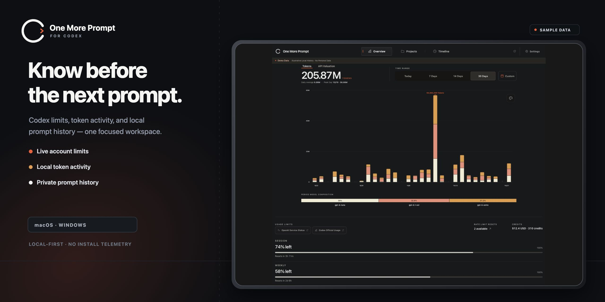
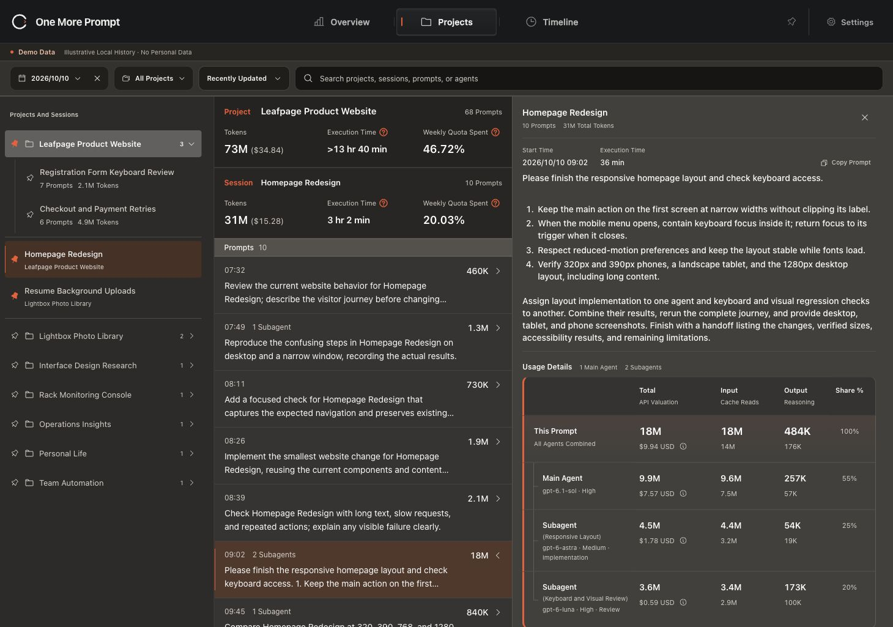
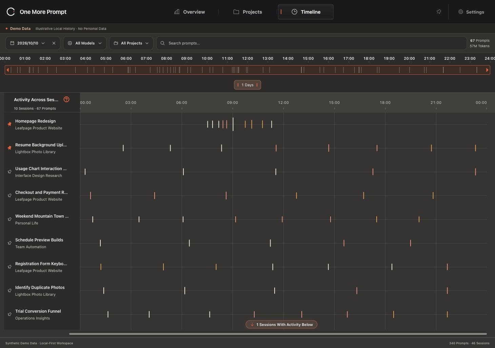
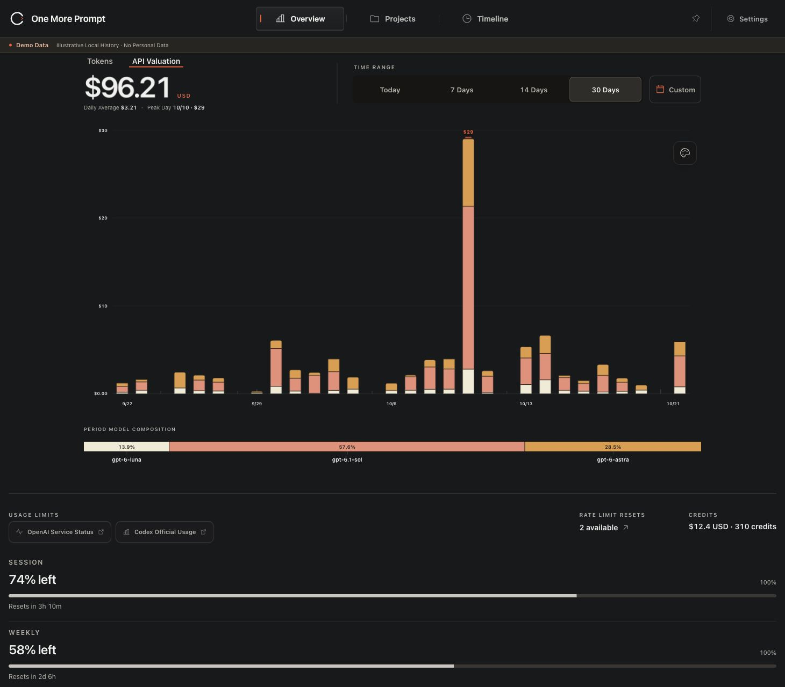
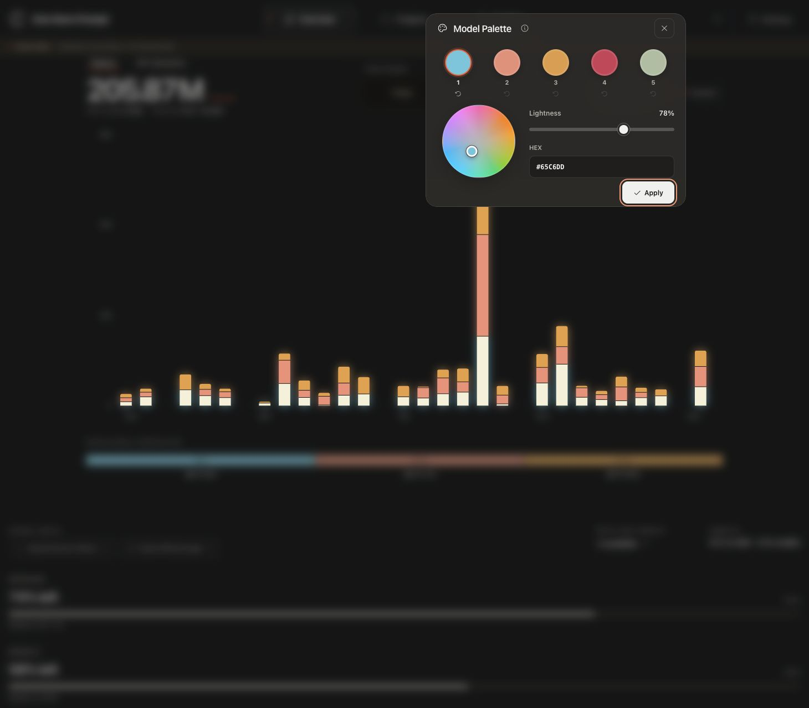

<p align="center">
  <picture>
    <source media="(prefers-color-scheme: dark)" srcset="assets/brand/logo-dark.svg">
    <source media="(prefers-color-scheme: light)" srcset="assets/brand/logo-light.svg">
    
  </picture>
</p>
<h1 align="center">One More Prompt</h1>
<p align="center"><strong>Know Your Codex Usage. Keep Your Work in View.</strong></p>
<p align="center"><strong>English</strong> · <a href="README.zh-TW.md">繁體中文</a> · <a href="README.zh-CN.md">简体中文</a> · <a href="README.ja.md">日本語</a> · <a href="README.ko.md">한국어</a> · <a href="README.es.md">Español</a> · <a href="README.pt-BR.md">Português (Brasil)</a> · <a href="README.de.md">Deutsch</a> · <a href="README.fr.md">Français</a></p>

One More Prompt is a local-first desktop app for **Codex account limits, Token activity, and prompt history**. Move from a usage spike to its project, conversation, and original prompt without uploading your history to an analytics service.

<p align="center"></p>

<details>
<summary>See The Workspace</summary>









</details>

## Release Status

> v1.0.0 is the first stable public release for macOS (Apple Silicon) and Windows (x64).

[GitHub](https://github.com/alanchill-dev/one-more-prompt) · [macOS / Windows](https://github.com/alanchill-dev/one-more-prompt/releases) · [Release Notes](docs/release-notes/v1.0.0.md)

## What You Can Do

- **See Your Limits.** Check available account windows, reset times, and remaining quota from the menu bar or system tray.
- **Understand Your Activity.** Start with Today, compare longer periods, customize model colors, and switch between Tokens and API Valuation. Estimates and their price calculations follow your selected currency; they are a usage reference, not a bill.
- **Find the Work Behind a Number.** Browse Projects → Sessions → Prompts, read original instructions and agent contributions, or explore the same records on Timeline. A `>` before a duration marks an incomplete total.
- **Keep Important Work Close.** Pin projects and conversations across date changes. Read ordinary and compressed `.jsonl.zst` history with the same accounting and browsing behavior.
- **Learn Without Risk.** Choose your language on the first setup screen; that choice stays with setup, the workspace, and the optional guide. Demo projects, conversations, prompts, and agents are localized in all nine languages. Replay Guide and Recheck Codex are separate actions.
- **Stay Current.** Check for new stable releases automatically; manual checking in Settings is always available. The icon immediately left of Settings appears with a dot only after a newer stable release for your platform is confirmed. You choose when to download and replace the app.

## Download and Start

- **macOS · Apple Silicon:** Open the signed and notarized Apple Silicon DMG, drag **One More Prompt.app** to Applications, and launch it.
- **Windows · x64:** Download the unsigned Windows x64 portable ZIP, extract the **whole folder**, and run `one-more-prompt.exe`. Keep its supporting files together.

Windows requires [Microsoft WebView2](https://developer.microsoft.com/microsoft-edge/webview2/#download-section). SmartScreen or company policies may warn about or block an unsigned app. Linux, Intel Mac, and native Windows ARM packages are not included.

Only the DMG or ZIP is needed to install or run the app. [SHA256SUMS.txt](https://github.com/alanchill-dev/one-more-prompt/releases/download/v1.0.0/SHA256SUMS.txt) lists hashes for optional download-integrity checks; it is neither an installer nor a digital signature.

Sign in through Codex using its standard local configuration. One More Prompt discovers existing records; no API key or manual credential copy is needed. The first setup screen offers all nine languages above, with English initially selected. You can change the saved choice in Settings.

## Updates

The app checks GitHub’s latest stable release on launch and when a six-hour check becomes due while the app is visible, or when you return to it. **Check for Updates** in Settings checks immediately. Checking sends no Codex credentials or prompt history. Download the offered package, quit the app, and replace the app or complete Windows folder; preferences and local product data stay in the normal per-user data location. This is manual replacement, without automatic installation or an updater feed. See [Update Help](docs/updates.md).

## Local by Design

Prompt text, project names, session names, and browsing stay on your computer. Quota refresh uses your existing local Codex credentials to contact OpenAI. Release checks contact GitHub anonymously. The read-only local API binds to `127.0.0.1:6736` and excludes Prompt Usage details. There is no installation telemetry.

## Documentation

- [Getting Started](docs/getting-started.md)
- [Codex Data and Authentication](docs/providers/codex.md)
- [Updates](docs/updates.md)
- [Local HTTP API](docs/local-http-api.md)
- [Usage Alerts](docs/notifications.md)
- [Proxy Configuration](docs/proxy.md)
- [Diagnostic Logs](docs/capture-logs.md)
- [Release Guide](docs/releasing.md)

## Build From Source

Use Bun and a Rust toolchain. macOS needs Xcode Command Line Tools; Windows needs Visual Studio C++ Build Tools and WebView2. Build and test locally; GitHub Actions is not used.

```sh
bun install
bun run bundle:plugins
bun run test --run
cargo test --locked --manifest-path src-tauri/Cargo.toml
bun run build
bun run tauri dev
```

See [Contributing](CONTRIBUTING.md) for checks and [the release guide](docs/releasing.md) for signed/notarized macOS DMGs and Windows ZIPs. This repository bundles **only the Codex integration**. Linux is planned.

## Support and License

Use [Support](SUPPORT.md) for bugs and feature requests. Report vulnerabilities through [Security](SECURITY.md). One More Prompt is independent and is not an official OpenAI product. Distributed under the [MIT License](LICENSE); required third-party copyright and attribution are preserved in [NOTICE](NOTICE) and [Trademark & Attribution](TRADEMARK.md).
